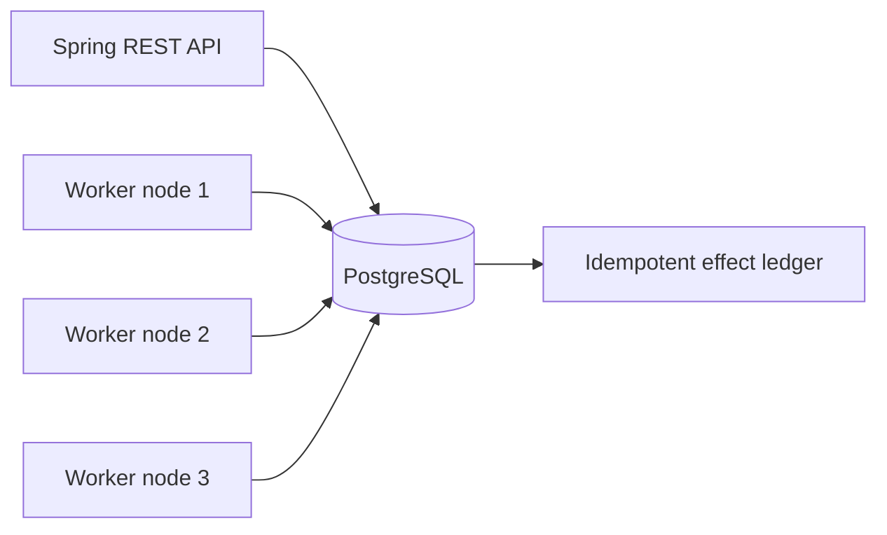

# Distributed trip job scheduler design

## Architecture



There are 256 logical shards. Every live node heartbeats in PostgreSQL every second; nodes consider a heartbeat dead after five seconds. Shards are assigned by sorted node ID and shard modulo node count. This deliberately simple mapping moves many shards on membership changes, but there is no global job lock. Each worker selects due jobs only from its shards, using `FOR UPDATE SKIP LOCKED`. A job's durable `next_fire_at` is advanced in the same transaction that inserts its run. The unique `(job_id, scheduled_at)` key prevents duplicate materialization during handoff. A separate run table holds leases and monotonically increasing fencing tokens.

PostgreSQL `clock_timestamp()` is the authority for due times, lease expiry, retry availability, and completion checks. Node clocks are used only for scheduling the next poll and logging. A stale node cannot commit after its lease expires: effect insertion and run completion share one transaction, which locks the run row and checks the current fence, owner, lease and maximum run time. The worker has 16 execution threads per node. A tenant gets one of its preallocated slot rows before a run can start, so its concurrent runs cannot exceed its configured cap. A claim query samples tenant candidates, then takes at most eight runs per tenant per transaction to keep both fairness and batch throughput.

```mermaid
sequenceDiagram
  participant A as Node A
  participant DB as PostgreSQL
  participant B as Node B
  A->>DB: Claim run; fence=1, lease until T
  Note over A: SIGSTOP or crash
  B->>DB: After T, claim same run; fence=2
  B->>DB: Lock run, verify fence 2 and lease, insert effect, mark success
  A->>DB: Lock run, verify fence 1
  DB-->>A: Reject stale completion
```

The committed `effect` row is the reference side effect. Its idempotency key is derived from job ID and scheduled instant (manual runs use their run ID). If an external cab alert service is connected, it must accept and deduplicate this key, or the design must use a transactional outbox plus downstream idempotency. Exactly-once *execution* is impossible after a process crash because the caller cannot know whether a remote effect happened before an acknowledgement was lost. This implementation guarantees exactly one committed local effect per run and at-least-once attempts. It does not claim exactly-once delivery to arbitrary external systems.

## Time and failure semantics

- Cron uses the tenant's IANA zone. The 02:30 occurrence in a spring gap is skipped. The 01:30 occurrence in a fall overlap fires once at the earlier offset. These choices have explicit tests.
- A run more than two seconds late follows the job's misfire policy. `FIRE_NOW` materializes all missed cron occurrences in batches of 500. `SKIP` drops them. `COALESCE` leaves one run for the latest missed occurrence. The persisted cursor prevents replaying old occurrences after restart.
- A failed effect transaction gets exponential backoff with half-to-full jitter, capped at five minutes. After five attempts it enters `DEAD`; an operator can inspect and replay it.
- `pause` prevents new materialization and claims. In-flight attempts may finish. Resuming catches up according to each job's misfire policy.
- A node crash can delay takeover by the five-second membership window and, for already claimed runs, up to the 15-second lease. A frozen node's stale completion is rejected.

| Failure | Visible outcome | Recovery |
|---|---|---|
| Node killed after claim | Run remains `RUNNING` until lease expires | Another node claims with a higher fence |
| Node frozen past lease | Old attempt may resume | Fence and DB lease checks reject its commit |
| Duplicate materialization | None | Unique job/instant and idempotency constraints |
| PostgreSQL unavailable | API and scheduling unavailable | Retry on restored database; durable jobs catch up |
| Effect transaction error | Run becomes `RETRY` | Backoff; eventually `DEAD` for operator replay |
| Tenant flood | Its own jobs queue | Slot cap and tenant-diverse claim query preserve other tenants |

## Complexity and limits

For `J` due jobs and `R` due runs, each shard's indexed scan is approximately `O(log J + batch)` and claim selection is approximately `O(log R + candidates)`, with extra work from the tenant-diverse subquery. Materializing `m` missed cron occurrences costs `O(m)` time and rows. Durable space is `O(jobs + runs + effects + slots)`. The dominant scaling limit is PostgreSQL write throughput and the tenant-diverse claim query over a large ready-run backlog. A 100,000-run/10-minute workload requires roughly 167 effect commits per second on average; a p99 lag below two seconds additionally requires enough burst capacity to drain the arrivals at each second. The reproducible three-node local benchmark in `scripts/benchmark-100k.sh` completed 100,000 distinct jobs with 100,000 effects and a 0.694-second p99 fire lag (see README for conditions). Capacity on other hardware still requires measurement. Partitioning the run table and using a dedicated outbox dispatcher are likely next steps at higher loads.

The design favors consistency of the local effect over availability during a database outage. Tenant zones are cached with a 10,000-entry size bound and a 60-second time-to-live. Tenant zones are immutable through this API; a direct database edit can take up to 60 seconds to reach a worker. No due-time, lease, or run state is cached. Production deployments need TLS termination, secret management, database backups, and a real idempotent downstream adapter.
